<div align="center" dir="rtl">


# ببالك · Bibalak

**احفظ ما تتعلّمه.** تطبيق سريع وخاص للتكرار المتباعد على ويندوز وماك
ولينكس، متوافق بالكامل مع Anki، بالعربية والإنجليزية.

[التنزيل](https://github.com/crrrowz/bibalak/releases/latest) ·
[دليل الاستخدام](docs/guides/user-guide.md) ·
[البناء من المصدر](#البناء-من-المصدر) ·
[English](README.md)

</div>

<div dir="rtl">

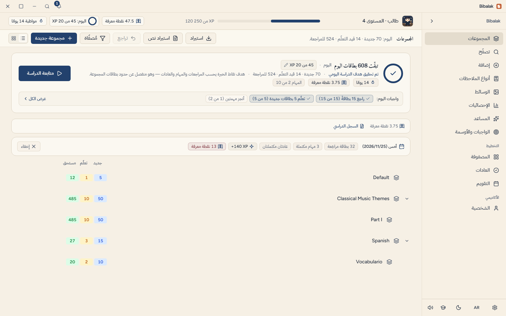

«ببالك» تعني بالعراقية «خلّيها في ذهنك». يجدول التطبيق مراجعاتك بحيث ترى كل
بطاقة قبيل أن تنساها، بخوارزميتَي FSRS وSM-2 نفسيهما المستخدمتين في Anki.
وتبقى مجموعتك على جهازك: لا حساب، ولا تتبّع، ولا حاجة إلى السحابة.

## لماذا ببالك

- **متوافق مع Anki دون أي فقدان.** افتح ملفات `.apkg` و`.colpkg`، وادرس، ثم
  صدّر إلى Anki متى شئت، مع الملاحظات والجدولة وسجل المراجعات والوسائط.
- **جدولة حديثة.** خوارزمية FSRS-6 لكل مجموعة مع أداة تُحسّن النموذج على سجل
  مراجعاتك أنت، أو خوارزمية SM-2 التقليدية.
- **مصمَّم للعربية كما للإنجليزية.** واجهة كاملة من اليمين إلى اليسار، وبحث
  يفهم العربية (يوحّد الحروف ويتجاهل التشكيل)، وخطوط مضمَّنة.
- **تخطيط بجانب الدراسة.** مصفوفة أيزنهاور ومتتبّع للعادات وتقويم، وكلها تعرف
  بطاقاتك المستحقة.
- **تحفيز يمكنك إيقافه.** أهداف يومية وتحديات وسلاسل أيام بثلاثة أنماط عرض:
  الافتراضي والأكاديمي واللعبة، يجمعها سجل تقدّم واحد.
- **مساعد ذكاء اصطناعي اختياري.** استخدم مفتاحك الخاص (يُحفظ في خزنة نظام
  التشغيل) أو نموذج Ollama محلياً، ولا يُرسل شيء قبل أن ترى بالضبط ما سيغادر
  جهازك.
- **قابل للتوسعة.** تعمل الإضافات في بيئة معزولة بصلاحيات تحددها أنت. لكتابة إضافة اقرأ [دليل الإضافات](docs/plugins/README.md) (بالإنجليزية).

## نظرة أقرب

| الدراسة                                   | تصفّح البطاقات (الوضع الداكن)                     |
| ----------------------------------------- | ------------------------------------------------- |
| 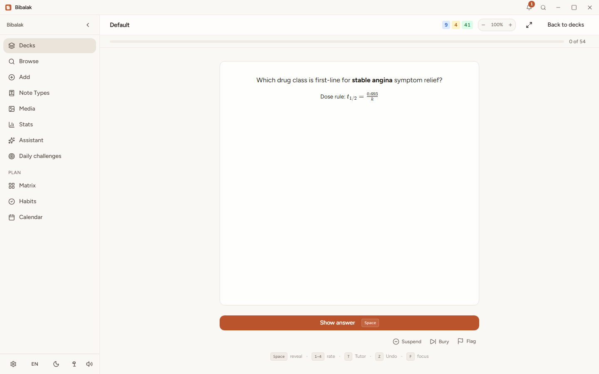      | 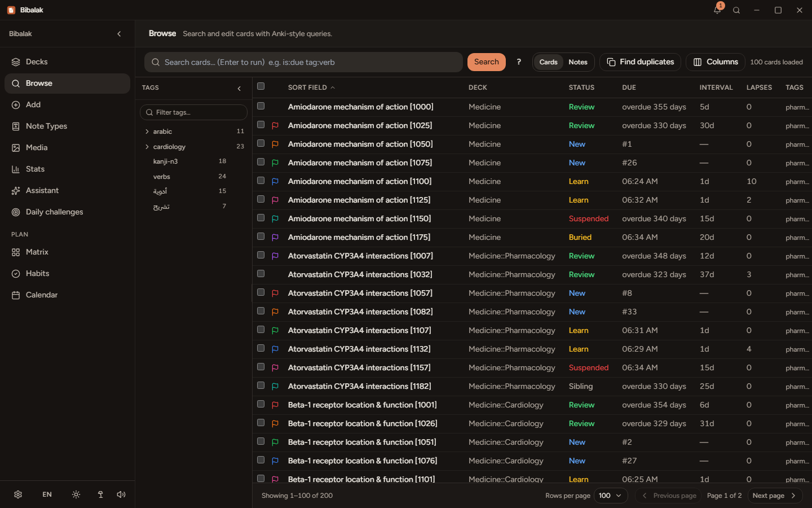          |
| **الإحصائيات**                            | **أنواع الملاحظات**                               |
| 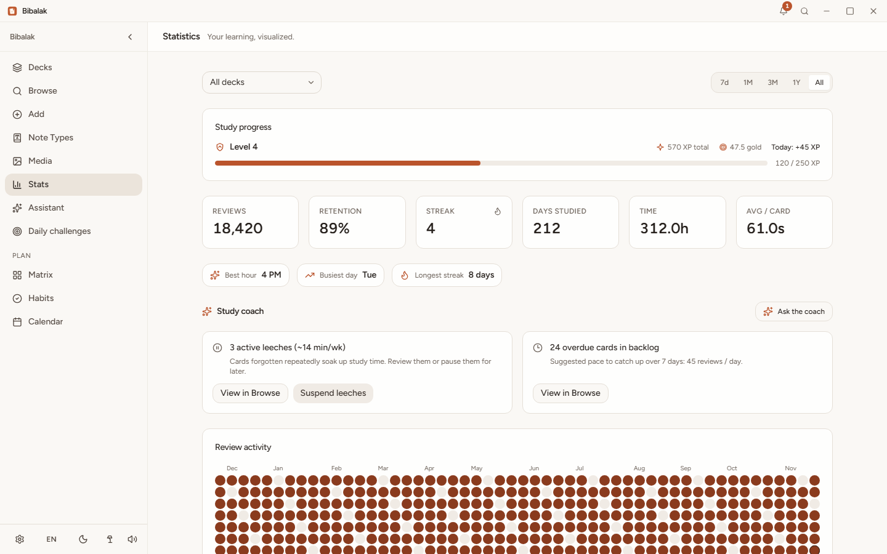       | 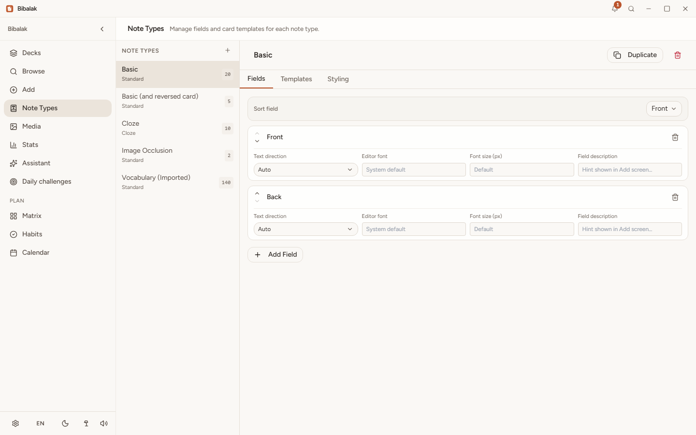 |
| **مصفوفة أيزنهاور**                       | **العادات**                                       |
| 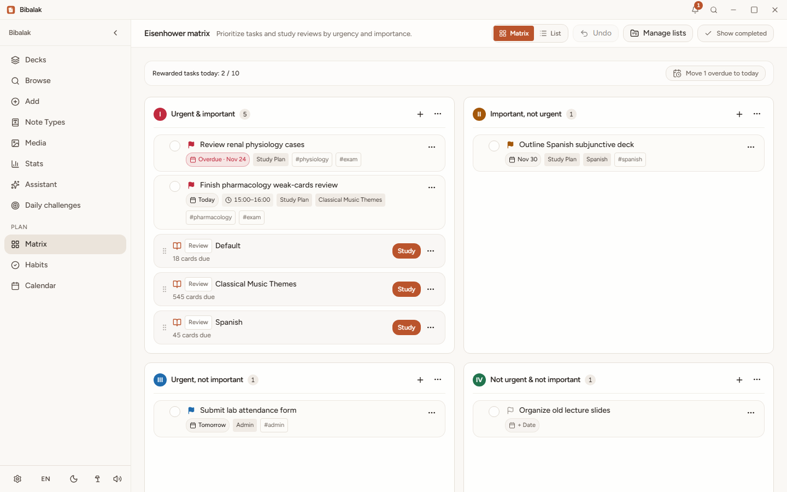 | 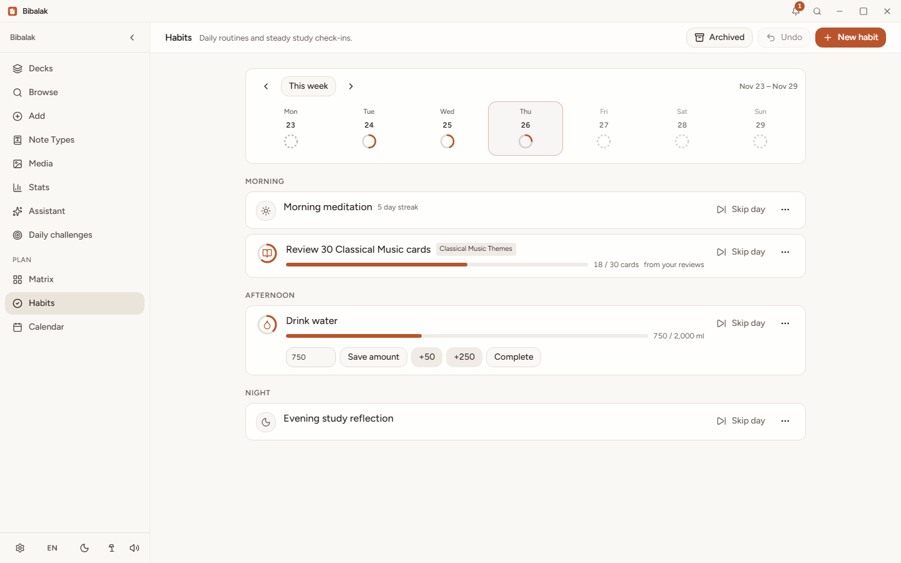           |
| **التقويم**                               | **الشخصية (نمط اللعبة)**                          |
| 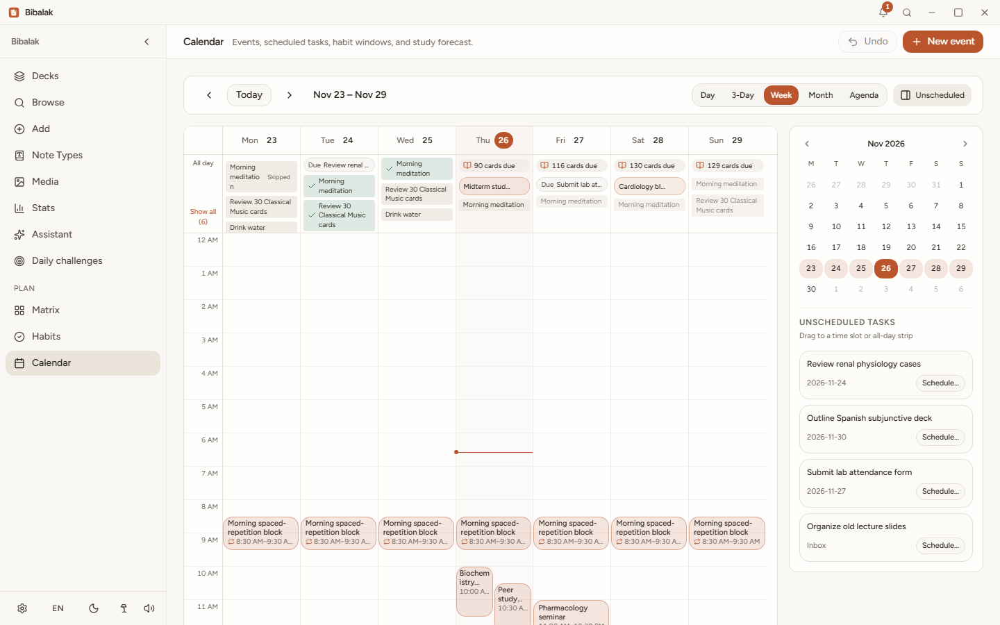       | 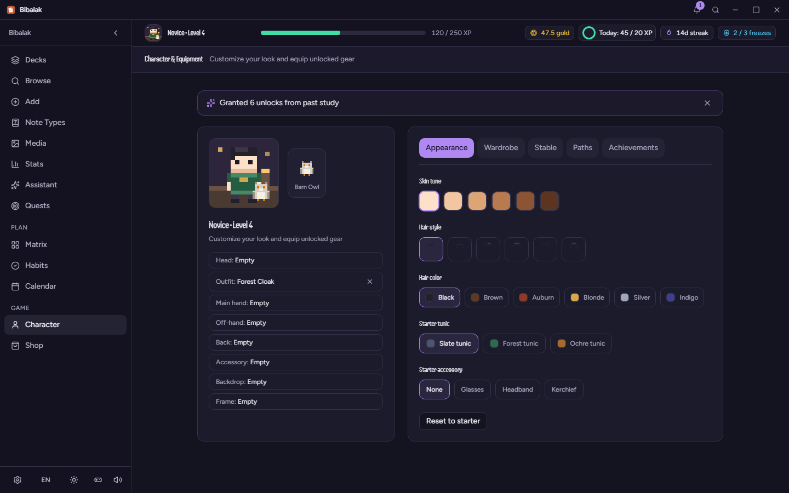         |
| **قائمة المجموعات**                       | **المساعد الذكي**                                 |
| 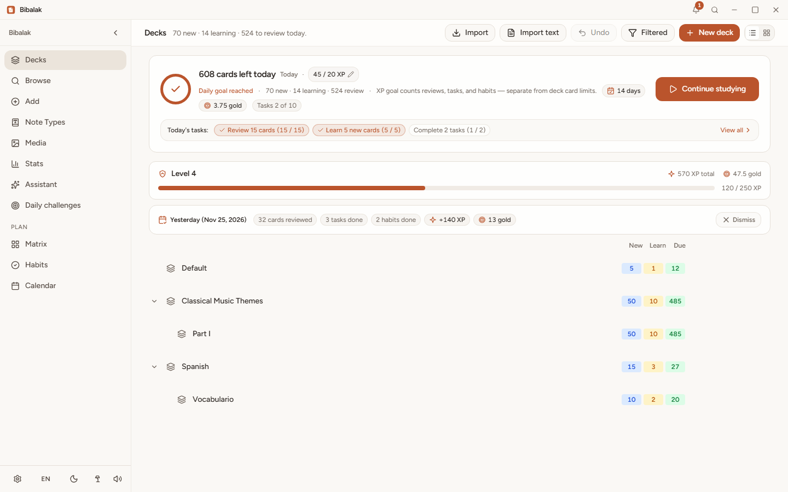  | 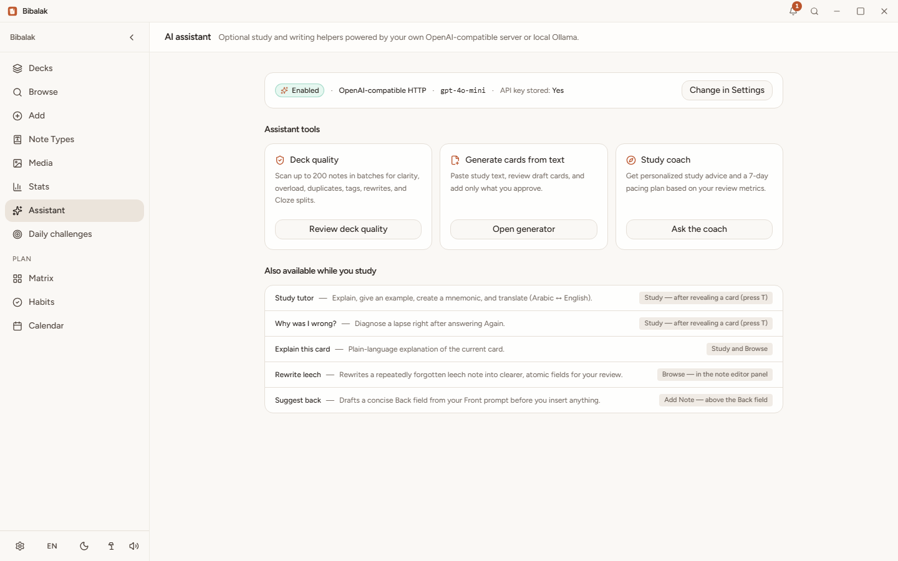        |

## التنزيل

نزّل أحدث إصدار من [صفحة الإصدارات](https://github.com/crrrowz/bibalak/releases/latest). يرافق
كل إصدار ملف `SHA256SUMS` للتحقق من سلامة التنزيل.

| النظام                      | الملف                                |
| --------------------------- | ------------------------------------ |
| ويندوز 10 / 11              | `Bibalak_<version>_x64-setup.exe`    |
| ويندوز بلا تثبيت (محمول)    | `Bibalak_<version>_x64_portable.zip` |
| ويندوز عبر إدارة المؤسسات   | `Bibalak_<version>_x64_en-US.msi`    |
| ماك بمعالج Apple (M1 فأحدث) | `Bibalak_<version>_aarch64.dmg`      |
| ماك بمعالج Intel            | `Bibalak_<version>_x64.dmg`          |
| لينكس                       | `.AppImage` أو `.deb` أو `.rpm`      |

> [!NOTE]
> لم يُوقَّع ببالك بعدُ بشهادة نظام تشغيل، لذلك يظهر تحذير عند أول تشغيل. على
> **ويندوز** اختر **More info ← Run anyway**، وعلى **ماك** انقر على التطبيق بالزر
> الأيمن واختر **Open**. يشرح [دليل التثبيت](docs/guides/install.md#unsigned-builds)
> كل الحالات.

**قادم من Anki؟** اختر في Anki **File ← Export** واحفظ ملف `.colpkg` (المجموعة
كلها) أو `.apkg` (مجموعة واحدة)، ثم استخدم **استيراد** في قائمة المجموعات.

## البناء من المصدر

تحتاج إلى [Rust](https://rustup.rs) 1.89 أو أحدث، و[Node.js](https://nodejs.org)
22 أو أحدث، و[pnpm](https://pnpm.io) 11، و[متطلبات Tauri](https://v2.tauri.app/start/prerequisites/)
لنظامك.

</div>

```sh
git clone https://github.com/crrrowz/bibalak
cd bibalak
pnpm install
cargo test -p bibalak-core   # يولّد أيضاً أنواع TypeScript للاتصال
pnpm dev                     # يشغّل التطبيق مع إعادة التحميل التلقائي
```

<div dir="rtl">

يشرح [دليل التثبيت](docs/guides/install.md) الوضع المحمول وبناء الإصدارات وحل
المشكلات، ويشرح [`ARCHITECTURE.ar.md`](ARCHITECTURE.ar.md) بنية التطبيق.

## المساهمة

نرحّب بتقارير الأخطاء والإصلاحات والترجمة والتوثيق. ابدأ من
[`CONTRIBUTING.md`](CONTRIBUTING.md) واقرأ [قواعد السلوك](CODE_OF_CONDUCT.md).
تتطلب طلبات الدمج توقيع [اتفاقية ترخيص المساهمين](CLA-INDIVIDUAL.md)، ويرشدك
روبوت الاتفاقية إلى ذلك في أول طلب دمج لك.

وجدت ثغرة أمنية؟ أبلغ عنها بشكل خاص كما في [`SECURITY.md`](SECURITY.md).

## الترخيص

يصدر ببالك بموجب [رخصة جنو أفيرو العمومية الإصدار 3.0 أو أحدث](LICENSE). أما
حزمة تطوير الإضافات في `packages/plugin-sdk` فمرخّصة بـ MIT لتتمكن الإضافات من
استخدام أي رخصة. بدأ ببالك تفرّعاً من مشروع Synapse (MIT)، وإشعاره وإشعارات
المكونات الخارجية محفوظة في [`THIRD_PARTY_NOTICES.md`](THIRD_PARTY_NOTICES.md).
ويخضع الاسم والشعار [لسياسة العلامة التجارية](TRADEMARKS.md).

حقوق النشر © 2026 Hassanein Hassan Alkahafji.

<sub>ببالك مشروع مستقل لا يرتبط بشركة Ankitects Pty Ltd ولا تؤيده. «Anki» علامة
تجارية لشركة Ankitects Pty Ltd.</sub>

</div>
