<div align="center">


# Bibalak

**Keep what you learn.** A fast, private spaced-repetition app for Windows,
macOS and Linux — fully compatible with Anki, in English and Arabic.

[Download](https://github.com/crrrowz/bibalak/releases/latest) ·
[User guide](docs/guides/user-guide.md) ·
[Build from source](#build-from-source) ·
[العربية](README.ar.md)

</div>

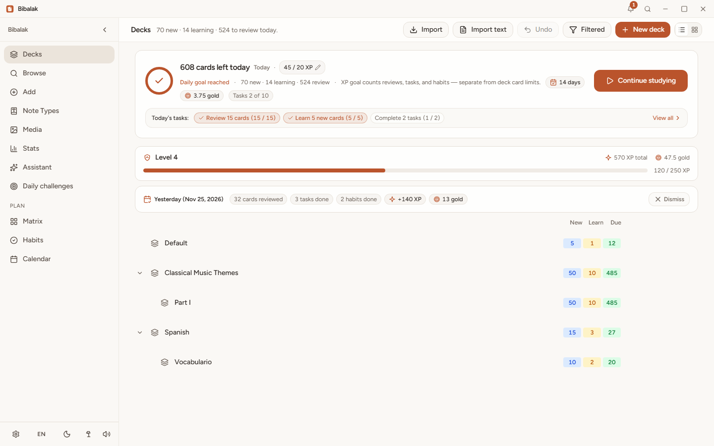

_Bibalak_ (ببالك) is Iraqi Arabic for "keep it in mind". The app schedules
your reviews so you see each card just before you would forget it, using the
same FSRS and SM-2 algorithms as Anki. Your collection stays on your computer:
there is no account, no tracking and no cloud requirement.

## Why Bibalak

- **Anki-compatible, without loss.** Open your `.apkg` and `.colpkg` files,
  study, and export back to Anki at any time — notes, scheduling, review
  history and media included.
- **Modern scheduling.** FSRS-6 per deck, with an optimiser that fits the
  model to your own review history, or classic SM-2.
- **Built for Arabic as much as English.** A complete right-to-left interface,
  Arabic-aware search (letters and diacritics folded) and bundled fonts.
- **Planning beside studying.** An Eisenhower matrix, habit tracker and
  calendar that understand your due cards.
- **Motivation you can switch off.** Daily goals, quests and streaks in three
  presentation styles — Default, Scholar or Game — all backed by one honest
  progress ledger.
- **Optional AI assistant.** Bring your own OpenAI-compatible key (kept in the
  operating-system keychain) or run a local Ollama model. Nothing is sent
  without a preview of exactly what leaves your machine.
- **Extensible.** Plugins run in an isolated worker with explicit permissions.

## A closer look

| Study                                       | Browse (dark theme)                                             |
| ------------------------------------------- | --------------------------------------------------------------- |
| 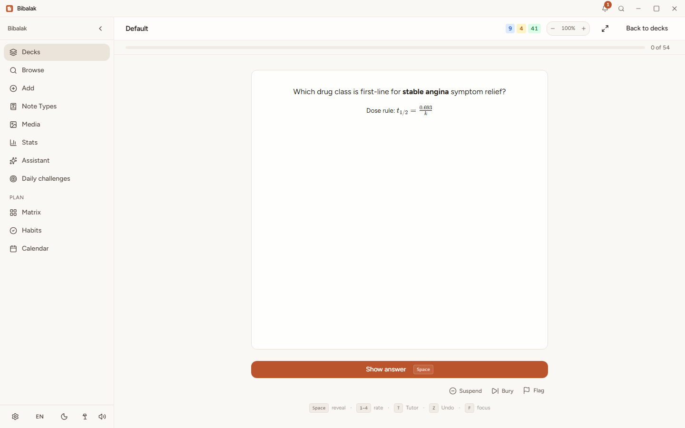    | 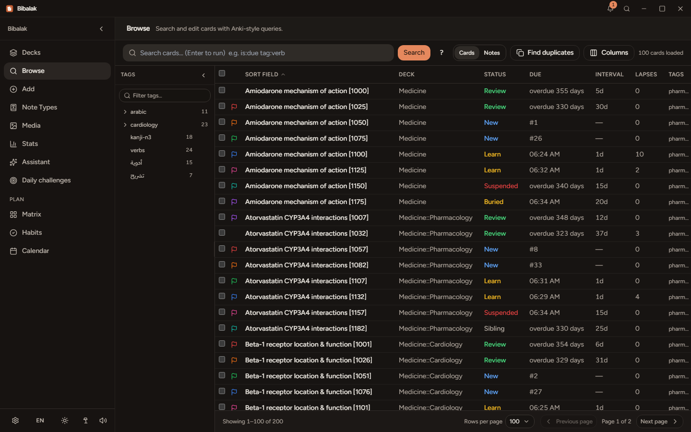        |
| **Statistics**                              | **Note types**                                                  |
| 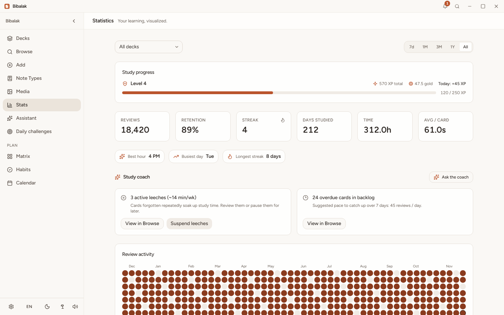         | 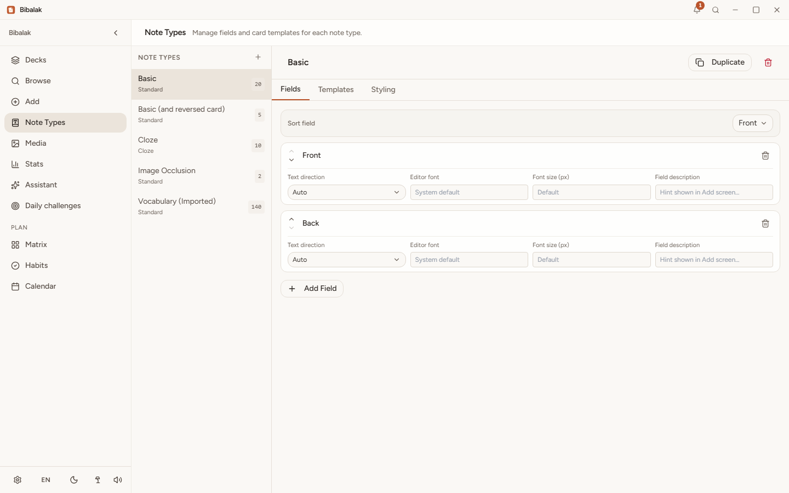                   |
| **Eisenhower matrix**                       | **Habits**                                                      |
| 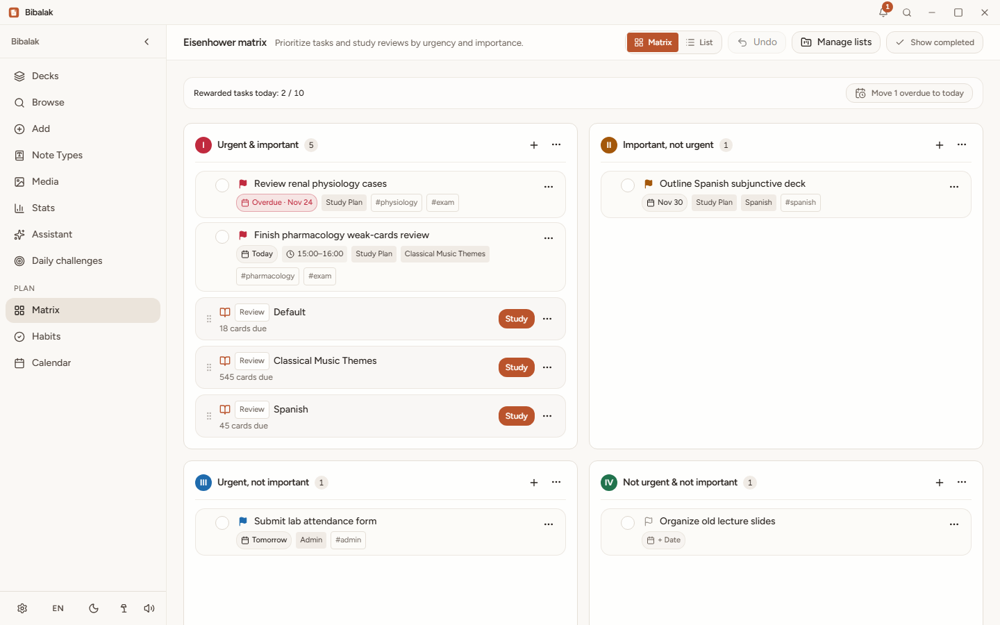 | 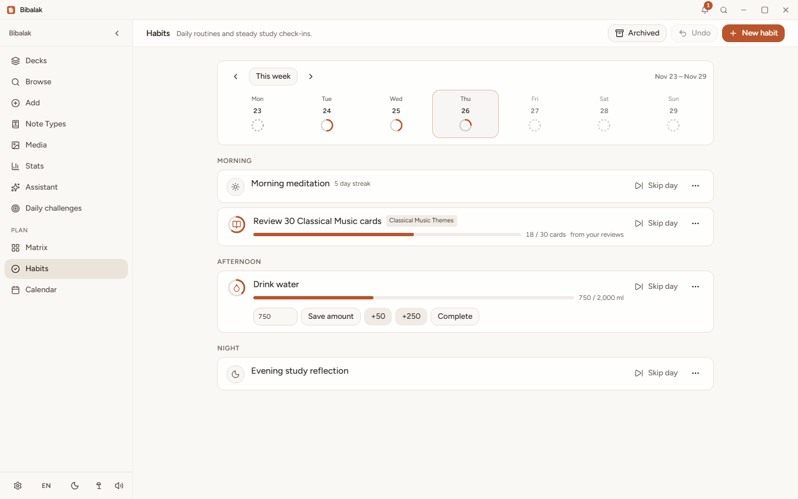                         |
| **Calendar**                                | **Character (Game style)**                                      |
| 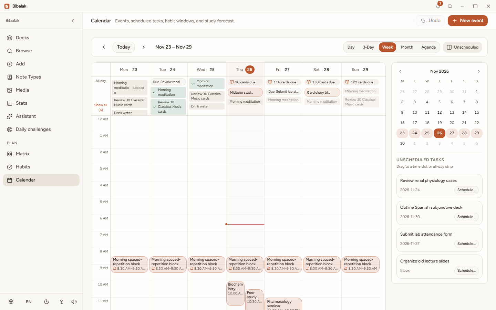        | 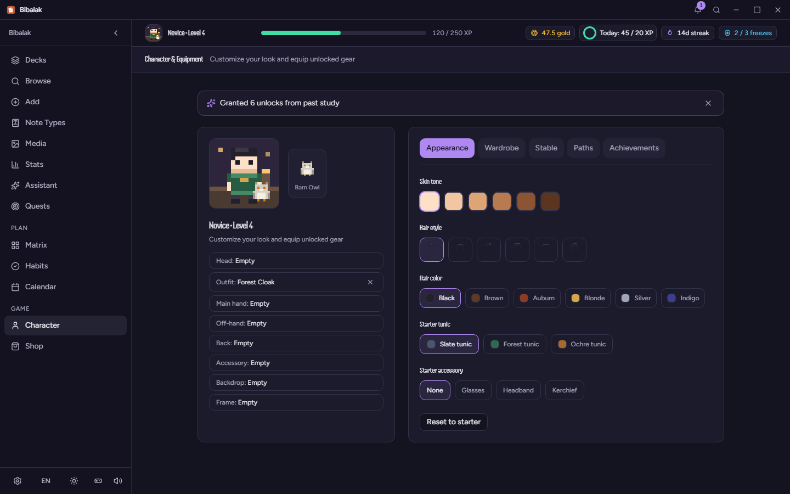 |
| **Arabic, right to left**                   | **AI assistant**                                                |
| 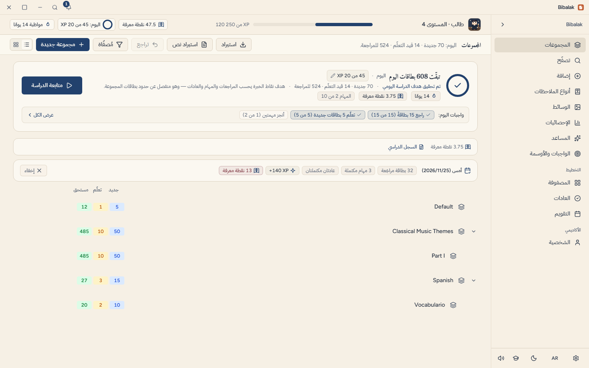  | 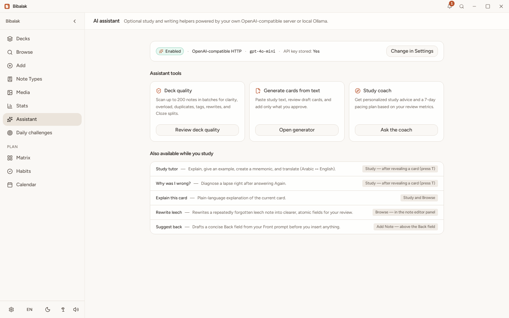                       |

## Download

Get the latest version from the
[Releases page](https://github.com/crrrowz/bibalak/releases/latest). Every release lists a
`SHA256SUMS` file so you can check your download.

| System                     | File                                 |
| -------------------------- | ------------------------------------ |
| Windows 10 / 11            | `Bibalak_<version>_x64-setup.exe`    |
| Windows, no install        | `Bibalak_<version>_x64_portable.zip` |
| Windows, managed install   | `Bibalak_<version>_x64_en-US.msi`    |
| macOS, Apple silicon (M1+) | `Bibalak_<version>_aarch64.dmg`      |
| macOS, Intel               | `Bibalak_<version>_x64.dmg`          |
| Linux                      | `.AppImage`, `.deb` or `.rpm`        |

> [!NOTE]
> Bibalak is not yet signed with an operating-system certificate, so the first
> launch shows a warning. On **Windows**, choose **More info → Run anyway**. On
> **macOS**, right-click the app and choose **Open**. The
> [install guide](docs/guides/install.md#unsigned-builds) covers every case.

**Coming from Anki?** In Anki choose **File → Export**, save a `.colpkg` (whole
collection) or `.apkg` (one deck), then use **Import** on Bibalak's deck list.

## Build from source

You need [Rust](https://rustup.rs) 1.89 or newer, [Node.js](https://nodejs.org)
22 or newer, [pnpm](https://pnpm.io) 11 and the
[Tauri prerequisites](https://v2.tauri.app/start/prerequisites/) for your
system.

```sh
git clone https://github.com/crrrowz/bibalak
cd bibalak
pnpm install
cargo test -p bibalak-core   # also generates the TypeScript IPC types
pnpm dev                     # run the desktop app with hot reload
```

| Command          | What it does                                                     |
| ---------------- | ---------------------------------------------------------------- |
| `pnpm dev`       | Desktop app with hot reload                                      |
| `pnpm dev:web`   | Interface only, on sample data, at `localhost:1420/preview.html` |
| `pnpm check`     | Every check that CI runs (format, lint, Rust and TS tests)       |
| `pnpm build:app` | Installers for the current system                                |

The [install guide](docs/guides/install.md) explains portable mode, release
builds and troubleshooting.

## How it is built

Bibalak is a [Tauri 2](https://v2.tauri.app) desktop app: a Rust core with no
UI or network dependencies, SQLite storage that keeps Anki's schema, and a
React 19 interface. Card templates render in a sandboxed frame so shared decks
cannot reach your data. Read [`ARCHITECTURE.md`](ARCHITECTURE.md) for the map
and [`docs/architecture/adr/`](docs/architecture/adr/README.md) for the
decisions behind it.

## Contributing

Bug reports, fixes, translations and documentation are all welcome. Start with
[`CONTRIBUTING.md`](CONTRIBUTING.md); please also read the
[Code of Conduct](CODE_OF_CONDUCT.md). Pull requests need a signed
[Contributor License Agreement](CLA-INDIVIDUAL.md) — the CLA bot walks you
through it on your first pull request.

Found a security problem? Please report it privately as described in
[`SECURITY.md`](SECURITY.md).

## License

Bibalak is released under the
[GNU Affero General Public License v3.0 or later](LICENSE). The plugin SDK in
`packages/plugin-sdk` is MIT-licensed so plugins can use any license. Bibalak
began as a fork of Synapse (MIT); that notice and all third-party notices are
kept in [`THIRD_PARTY_NOTICES.md`](THIRD_PARTY_NOTICES.md). The name and logo
are covered by the [trademark policy](TRADEMARKS.md).

Copyright © 2026 Hassanein Hassan Alkahafji.

<sub>Bibalak is an independent project and is not affiliated with or endorsed
by Ankitects Pty Ltd. "Anki" is a trademark of Ankitects Pty Ltd.</sub>
